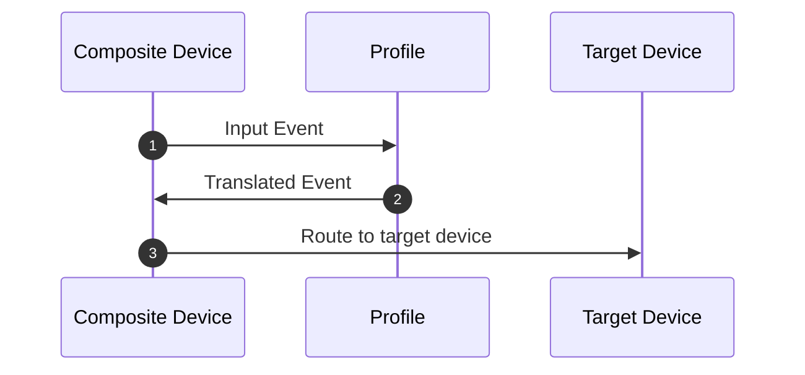
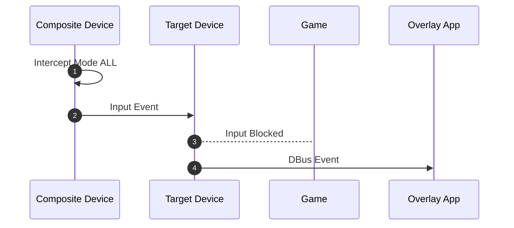
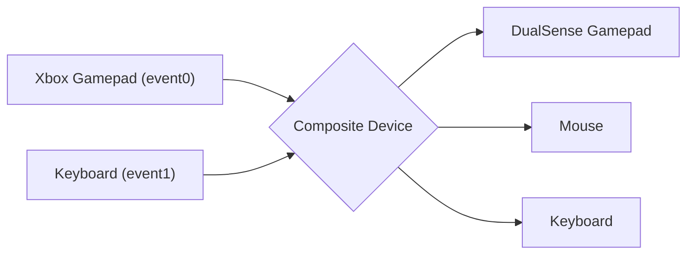
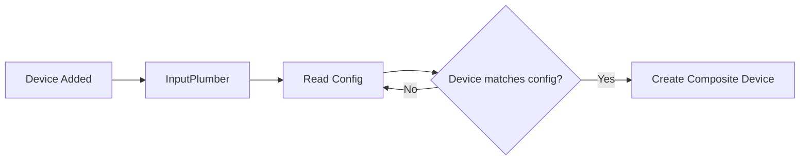

# Usage

When InputPlumber is running as a service, you can interact with it over DBus.
There are various DBus libraries available for popular programming languages
like Python, Rust, C++, etc.

You can also interface with DBus using the `busctl` command:

```bash
busctl tree org.shadowblip.InputPlumber
```

### Input Profiles

InputPlumber is capable of loading input device profiles to translate inputs into
any other supported input event. Input profiles are defined as YAML configuration
files that can be loaded on-demand for any device that InputPlumber manages. The
format of an input profile config is defined by the [Device Profile Schema](https://raw.githubusercontent.com/ShadowBlip/InputPlumber/main/rootfs/usr/share/inputplumber/schema/device_profile_v1.json) to make it easier to create profiles.



Typically input profiles should be generated using an external tool, but you
can manually create your own profiles using any text editor. If you use an editor
that supports the [YAML Language Server](https://github.com/redhat-developer/yaml-language-server)
you can write profiles with auto-complete and usage information.

Here is a short example:

```yaml
# yaml-language-server: $schema=https://raw.githubusercontent.com/ShadowBlip/InputPlumber/main/rootfs/usr/share/inputplumber/schema/device_profile_v1.json
version: 1
kind: DeviceProfile
name: Start Button to Escape Key
description: Profile to map a gamepad's start button to the Escape keyboard key

mapping:
  - name: Menu
    source_event:
      gamepad:
        button: Start
    target_events:
      - keyboard: KeyEsc
```

This example will remap the `Start` button from a gamepad to the `ESC` key.

To load the input profile, you can use the `LoadProfilePath` method on the input
device you want the profile applied to. You can also do this from the command
line using `busctl`:

```bash
busctl call org.shadowblip.InputPlumber \
  /org/shadowblip/InputPlumber/CompositeDevice0 \
  org.shadowblip.Input.CompositeDevice \
  LoadProfilePath "s" /usr/share/inputplumber/profiles/mouse_keyboard_wasd.yaml
```

### Intercept Mode

Intercept Mode is a feature of InputPlumber that can allow external applications
to intercept input events from an input device and re-route them over DBus
instead. The primary use case for this feature is typically to allow overlay
applications (like [OpenGamepadUI](https://github.com/ShadowBlip/OpenGamepadUI))
to stop input from reaching other running applications (like a game),
allowing the overlay to process inputs without those inputs leaking into other
running apps.



You can set the intercept mode by setting the `InterceptMode` property on the
input device you want to intercept input from. The intercept mode can be one
of three values:

- `0` (NONE) - No inputs are intercepted and re-routed
- `1` (PASS) - No inputs are intercepted and re-routed _except_ for gamepad `Guide` events. Upon receiving a gamepad `Guide` event, the device is automatically switched to intercept mode `2` (ALL).
- `2` (ALL) - All inputs are intercepted and re-routed over DBus
- `3` (GAMEPAD_ONLY) - All gamepad inputs are intercepted and re-routed over DBus

Typically the intercept mode should be handled by an external application, but
you can also set the intercept mode from the command line using `busctl`:

```bash
busctl set-property org.shadowblip.InputPlumber \
  /org/shadowblip/InputPlumber/CompositeDevice0 \
  org.shadowblip.Input.CompositeDevice \
  InterceptMode u 2
```

### Target Groups

Target groups let several sessions, sandboxes or containers each have their
own virtual gamepad from the same physical controller. Only the session in
front gets the input. The others keep their gamepad connected and at rest, so
a game in the background sees an idle controller instead of an unplugged one.

Each composite device keeps one gamepad of each gamepad target type per group.
Only the gamepads of the `ActiveTargetGroup` receive input. Switching groups
leaves the old group's gamepads with every button released and every axis
centred. Keyboard, mouse, touchpad, touchscreen and DBus targets are shared by
all groups, because a compositor already sends those to whatever is in front.
Intercept mode applies to the active group's gamepads as before.

Groups are managed on the Manager (`/org/shadowblip/InputPlumber/Manager`):

- `AddTargetGroup(s)` and `RemoveTargetGroup(s)`. The active group can only be
  removed last.
- `ActiveTargetGroup` (read/write). Setting a group that does not exist adds it
  first.
- `TargetGroups` (read).

With no groups, InputPlumber creates one set of targets per device, as it
always has. Groups and the active one are kept in
`/run/inputplumber/target-groups` across daemon restarts.

```bash
busctl call org.shadowblip.InputPlumber /org/shadowblip/InputPlumber/Manager \
  org.shadowblip.InputManager AddTargetGroup s desktop
busctl set-property org.shadowblip.InputPlumber /org/shadowblip/InputPlumber/Manager \
  org.shadowblip.InputManager ActiveTargetGroup s game
```

A group's gamepads have the physical path `inputplumber/group/<name>`. For
a UHID gamepad it is the HID device's (`HID_PHYS`): some kernel drivers, such
as the DualSense's, leave the input devices' own physical path empty.
InputPlumber keeps one view of `/dev/input` per group in
`/dev/inputplumber/groups/<name>/`. The view holds hard links of every node in
`/dev/input` except other groups' gamepads, so virtual gamepads made by other
software, such as Steam Input's, stay visible. Bind a group's directory, not
its nodes, as a sandbox's `/dev/input`, and gamepads plugged in later appear
there.

A grouped gamepad's hidraw node cannot be shown to one group alone, because it
sits directly in `/dev`. The `71-inputplumber-target-groups.rules` udev rule
closes those nodes to everyone, so grouped gamepads are read through evdev. The
`deck` target is a USB device whose physical path the kernel sets, so it cannot
carry a group; use `deck-uhid` with groups.

The `inputplumber-client` crate in `client/` is an MIT-licensed zbus client
for the Manager interface, groups included.

### Virtual Keyboard

When InputPlumber is running, a virtual keyboard is created that is used for
sending keyboard inputs. You can also use this keyboard to send keyboard events
using the DBus interface with the `SendKey` method. You can do this from the
command line using `busctl`:

```bash
busctl call org.shadowblip.InputPlumber \
  /org/shadowblip/InputPlumber/devices/target/keyboard0 \
  org.shadowblip.Input.Keyboard \
  SendKey sb KEY_ESC 1
```

### Device Compositing & Capability Maps

One feature of InputPlumber is the ability to combine multiple input devices
together into a single logical input device called a "Composite Device". This is
often required for many handheld gaming PCs that have built-in gamepads with
special non-standard buttons that show up as multiple independent input devices,
like a gamepad and a keyboard.




Composite devices are defined as YAML configuration files that follow the
[Composite Device Schema](https://raw.githubusercontent.com/ShadowBlip/InputPlumber/main/rootfs/usr/share/inputplumber/schema/composite_device_v1.json)
to combine the defined input devices together. When InputPlumber starts up, it
looks at all the input devices on the system and checks to see if they match a
composite device configuration. If they do, the input devices are combined into
a single logical composite device.



A composite device configuration looks like this:

```yaml
# yaml-language-server: $schema=https://raw.githubusercontent.com/ShadowBlip/InputPlumber/main/rootfs/usr/share/inputplumber/schema/composite_device_v1.json
version: 1
kind: CompositeDevice
name: OneXPlayer Intel

# Only check for source devices if *any* of the given data matches. If this list is
# empty, then the source devices will *always* be checked.
matches:
  - dmi_data:
      product_name: ONEXPLAYER
      sys_vendor: ONE-NETBOOK
      cpu_vendor: GenuineIntel
  - dmi_data:
      product_name: ONE XPLAYER
      sys_vendor: ONE-NETBOOK TECHNOLOGY CO., LTD.
      cpu_vendor: GenuineIntel

# One or more source devices to combine into a single virtual device. The events
# from these devices will be watched and translated according to the capability map.
source_devices:
  - group: gamepad
    evdev:
      name: OneXPlayer Gamepad
      phys_path: usb-0000:00:14.0-9/input0
  - group: keyboard
    evdev:
      name: AT Translated Set 2 keyboard
      phys_path: isa0060/serio0/input0

# The target input device(s) that will be created for this composite device
target_devices:
  - gamepad
  - mouse
  - keyboard

# The ID of a device capability mapping in the 'capability_maps' folder
capability_map_id: oxp1
```

In addition to combining multiple input devices together, composite devices can
also have a "Capability Map" to define the real capabilities of the input
device. This is commonly necessary for handheld gaming PCs where special
non-standard buttons will emit keyboard events (like `CTRL`+`ALT`+`DEL`) instead
of actual gamepad events.

Capability maps are defined in a separate YAML configuration file that follows
the [Capability Map Schema](https://raw.githubusercontent.com/ShadowBlip/InputPlumber/main/rootfs/usr/share/inputplumber/schema/capability_map_v2.json)
and are referenced by their unique ID.

A capability map configuration looks like this:

```yaml
# yaml-language-server: $schema=https://raw.githubusercontent.com/ShadowBlip/InputPlumber/main/rootfs/usr/share/inputplumber/schema/capability_map_v2.json
version: 2
kind: CapabilityMap
name: OneXPlayer Type 1
id: oxp1

# List of mapped events
mapping:
  - name: A to B
    source_events:
      - evdev:
          event_type: KEY
          event_code: BTN_SOUTH
          value_type: button
    target_event:
      gamepad:
        button: East

  - name: B to A
    source_events:
      - evdev:
          event_type: KEY
          event_code: BTN_EAST
          value_type: button
    target_event:
      gamepad:
        button: South

  - name: X + Y to Start
    mapping_type:
      evdev: chord
    source_events:
      - evdev:
          event_type: KEY
          event_code: BTN_WEST
          value_type: button
      - evdev:
          event_type: KEY
          event_code: BTN_NORTH
          value_type: button
    target_event:
      gamepad:
        button: Start

  - name: X to Y delay
    mapping_type:
      evdev: delayed_chord
    source_events:
      - evdev:
          event_type: KEY
          event_code: BTN_NORTH
          value_type: button
    target_event:
      gamepad:
        button: West
```

### Environment Variables

Some aspects of InputPlumber can be controlled with environment variables. This
is the current list of environment variables that are used:

| Variable | Default | Description |
| -------- | ------- | ----------- |
| `LOG_LEVEL` | info | Log level to use. Can be one of: 'error', 'warn', 'info', 'debug', 'trace' |
| `HIDE_DEVICES_FROM_ROOT` | 0 | Try to hide the device from elevated processes by moving the device node to `/dev/inputplumber/sources`. |
| `ENABLE_METRICS` | 0 | Enable input latency monitoring (debug builds only). Metrics can be viewed with `inputplumber device <id> target monitor <target>`. |
| `INSECURE_DISABLE_POLKIT` | 0 | Disable polkit authorization (NOT RECOMMENDED) |


### Troubleshooting

Find the InputPlumber version:

```bash
inputplumber --version
```
```
inputplumber 0.58.7
```

Start InputPlumber with debug logs enabled.

Temporarily:

```bash
sudo systemctl stop inputplumber
sudo LOG_LEVEL=debug inputplumber
```

Permanently:

```bash
sudo cp /usr/lib/systemd/system/inputplumber.service /etc/systemd/system/
sudo sed -i 's/LOG_LEVEL=info/LOG_LEVEL=debug/g' /etc/systemd/system/inputplumber.service
sudo systemctl daemon-reload
sudo systemctl restart inputplumber
```

View debug logs:

```bash
sudo journalctl --unit inputplumber.service
```

List managed devices:

```bash
inputplumber devices list
```
```
╭────┬───────────────╮
│ Composite Devices  │
├────┼───────────────┤
│ Id │ Name          │
├────┼───────────────┤
│ 0  │ ASUS ROG Ally │
╰────┴───────────────╯
Found 1 composite device(s)
```

View the current intercept mode for the first managed device:

```bash
inputplumber device 0 intercept get
```
```
Current intercept mode: none
```

Change the intercept mode of the first device:

```bash
inputplumber device 0 intercept set --help
inputplumber device 0 intercept set $MODE
```

View what InputPlumber profiles are loaded and what event interfaces are being used:

```bash
inputplumber device 0 info
```
```
╭────┬───────────────┬──────────────┬─────────────────────────────────────────────────────────────────────────────────────────────────────────╮
│ Composite Device                                                                                                                            │
├────┼───────────────┼──────────────┼─────────────────────────────────────────────────────────────────────────────────────────────────────────┤
│ Id │ Name          │ Profile Name │ Source Devices                                                                                          │
├────┼───────────────┼──────────────┼─────────────────────────────────────────────────────────────────────────────────────────────────────────┤
│ 0  │ ASUS ROG Ally │ Default      │ ["/dev/hidraw2", "/dev/input/event3", "/dev/input/event4", "/dev/input/event5", "/dev/iio:device0", ""] │
╰────┴───────────────┴──────────────┴─────────────────────────────────────────────────────────────────────────────────────────────────────────╯
```

Find the related configuration file (replace "ASUS ROG Ally" with the "Name" from the previous output):

```bash
grep --recursive --files-with-matches --basic-regexp "name: ASUS ROG Ally$" /usr/share/inputplumber/devices/
```
```
/usr/share/inputplumber/devices/50-rog_ally.yaml
```

Start the built-in test tool (recommended to run in a separate window):

```bash
inputplumber device 0 test
```

View what input devices are being emulated for the first device:

```bash
inputplumber device 0 targets list
```
```
╭────────────┬───────────────────────────────╮
│ Target Devices                             │
├────────────┼───────────────────────────────┤
│ Id         │ Name                          │
├────────────┼───────────────────────────────┤
│ mouse      │ InputPlumber Mouse            │
├────────────┼───────────────────────────────┤
│ keyboard   │ InputPlumber Keyboard         │
├────────────┼───────────────────────────────┤
│ xbox-elite │ Microsoft X-Box One Elite pad │
╰────────────┴───────────────────────────────╯
```

View what events are being captured by InputPlumber:

```bash
sudo evtest
```
```
No device specified, trying to scan all of /dev/input/event*
Available devices:
/dev/input/event0:	Power Button
/dev/input/event1:	Sleep Button
/dev/input/event10:	HD-Audio Generic HDMI/DP,pcm=3
/dev/input/event11:	HD-Audio Generic Mic
/dev/input/event12:	HD-Audio Generic Mic
/dev/input/event13:	HD-Audio Generic Headphone
/dev/input/event14:	Microsoft X-Box One Elite 2 pad
/dev/input/event15:	InputPlumber Mouse
/dev/input/event16:	InputPlumber Keyboard
/dev/input/event2:	AT Translated Set 2 keyboard
/dev/input/event3:	Microsoft X-Box 360 pad
/dev/input/event4:	ROG Ally Keyboard
/dev/input/event5:	ROG Ally Mouse
/dev/input/event6:	NVTK0603:00 0603:F200
/dev/input/event7:	Video Bus
/dev/input/event8:	PC Speaker
/dev/input/event9:	Asus WMI hotkeys
Select the device event number [0-16]: 14
```

Stop InputPlumber and then view what events are being captured by the physical device:

```bash
sudo systemctl stop inputplumber
sudo evtest
```
```
No device specified, trying to scan all of /dev/input/event*
Available devices:
/dev/input/event0:	Power Button
/dev/input/event1:	Sleep Button
/dev/input/event10:	HD-Audio Generic HDMI/DP,pcm=3
/dev/input/event11:	HD-Audio Generic Mic
/dev/input/event12:	HD-Audio Generic Mic
/dev/input/event13:	HD-Audio Generic Headphone
/dev/input/event2:	AT Translated Set 2 keyboard
/dev/input/event3:	Microsoft X-Box 360 pad
/dev/input/event4:	ROG Ally Keyboard
/dev/input/event5:	ROG Ally Mouse
/dev/input/event6:	NVTK0603:00 0603:F200
/dev/input/event7:	Video Bus
/dev/input/event8:	PC Speaker
/dev/input/event9:	Asus WMI hotkeys
Select the device event number [0-13]: 3
```

